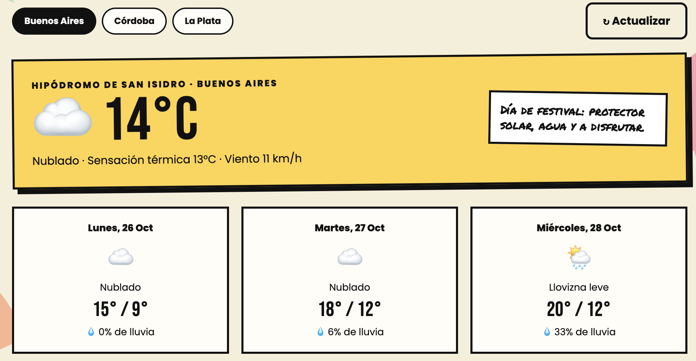

# ϟ WebFest 2026 · Segunda edición — Grupo 13

> Trabajo Práctico Grupal 2 · Desarrollo de Sistemas Web (Front End) · 2026, 2do cuatrimestre

**WebFest 2026** es la aplicación React del Grupo 13. Continúa el sitio del TP1, pensado como el afiche de un festival de música: cada integrante es un "artista" del line up. En esta edición el festival se mudó a React. Ahora tiene una **sidebar** compartida, perfiles armados con un mismo componente, una **cartelera** de bandas cargada desde un JSON local con búsqueda y filtro, el **clima de las sedes** consultado a una API pública, el **árbol de componentes** de la app y la **bitácora** del tour.

🔗 **Sitio publicado en Vercel:** https://tp-2-front-grupo13.vercel.app/

📁 **Repositorio:** https://github.com/aguscp/TP2_Front_Grupo13

---

## 📑 Índice

1. [Integrantes y responsabilidades](#-integrantes-y-responsabilidades)
2. [Secciones de la aplicación](#-secciones-de-la-aplicación)
3. [Tecnologías](#️-tecnologías)
4. [Cómo correrlo en tu compu](#-cómo-correrlo-en-tu-compu)
5. [Estructura del proyecto](#-estructura-del-proyecto)
6. [Guía de estilos](#-guía-de-estilos)
7. [Uso de IA](#-uso-de-inteligencia-artificial)

---

## 👥 Integrantes y responsabilidades

| # | Integrante | GitHub | Perfil en la app | Responsabilidad principal |
|---|------------|--------|------------------|---------------------------|
| 01 | Sebastián Sarango | [@DevJaSeb](https://github.com/DevJaSeb) | `/perfil/sebas` | Perfil propio, componente interactivo `SkillBars` con manejo de estado, corrección de compatibilidad de Vite con Node.js y ocultamiento de scrollbar en sidebar |
| 02 | Valentina Sánchez | [@ValentinaBS](https://github.com/ValentinaBS) | `/perfil/valen` | Perfil propio con la interacción `RandomPick`. Rediseño de la cartelera: tarjetas con la misma altura y detalle de cada banda en un modal (`BandModal`, con `<dialog>`). Revisión responsive y de accesibilidad (foco, cierre con Escape, atributos `aria`). Actualización del árbol de componentes y entrada de la bitácora |
| 03 | Agustín Cisneros | [@aguscp](https://github.com/aguscp) | `/perfil/agus` | Repositorio, base en React (rutas, sidebar y layout), cartelera con JSON, API de clima y árbol de componentes |
| 04 | Celina Tarn | [@celina-web](https://github.com/celina-web) | `/perfil/celi` | Desarrollo del perfil propio con interacción de un generador de frases. Implementación del soporte multidioma, incorporando la versión en inglés de la web y un selector de idioma en el footer. Revisión y corrección de errores en las traducciones.  |

---

## 🧭 Secciones de la aplicación

Todas las secciones se recorren desde la **sidebar**, que muestra la identidad del festival, los enlaces y la sección activa. En escritorio se puede contraer para dejar sólo los íconos (botón « / »). En celular y tablet se convierte en un panel que se abre con el botón ☰ y se cierra con la ✕, tocando afuera o con la tecla Escape. Además, cada pantalla tiene botones para seguir o volver, así que nunca hace falta usar el botón Atrás del navegador.

| Sección | Ruta | Qué tiene |
|---------|------|-----------|
| **Inicio** | `/` | Presentación del equipo, tarjetas que se dan vuelta con un resumen de cada integrante y botón de perfil al azar. |
| **Perfiles** | `/perfil/:slug` | Un mismo componente (`Profile`) para los 4 integrantes, con los datos de `members.json`. Cada perfil tiene su propia interacción. |
| **Cartelera** | `/cartelera` | 25 bandas de `lineup.json` con búsqueda por texto, filtro por género, mensaje de "sin resultados", botón para ver todas y detalle de cada banda en una ventana modal. |
| **Clima del festival** | `/clima` | Clima actual y pronóstico de 3 días de cada sede del tour, desde la API de Open-Meteo, con estados de carga y error y botones para actualizar y reintentar. |
| **Árbol de componentes** | `/arbol` | Jerarquía real de componentes de la app, con ramas que se expanden y contraen. |
| **Bitácora** | `/bitacora` | Entradas del proceso con forma de ticket, desplegables y filtro por TP. Sigue la bitácora del TP1. |

### Interacciones de cada perfil

- **Sebas:** barras de skills interactivas (`SkillBars`). Permite regular el nivel de dominio (1 a 5) en cada tecnología con botones + / −, indicadores visuales de progreso y mensajes motivacionales dinámicos al alcanzar el nivel máximo.
- **Valen:** recomendador al azar. Elige una película o un disco favorito y lo resalta en la lista.
- **Agus:** reproductor ficticio. Play, pausa y siguiente recorren sus discos con un ecualizador animado y una barra de progreso.
- **Celi:** generador de frases. Muestra una frase al azar de autores hispanos sin repetir la anterior.

### API pública: Open-Meteo

[Open-Meteo](https://open-meteo.com/) es una API de clima gratuita que **no necesita clave**, así que se consulta directo desde el navegador sin exponer datos privados. Aporta la temperatura actual, la sensación térmica, el viento, el estado del cielo y la probabilidad de lluvia de los próximos 3 días para las coordenadas de cada sede.


---

## 🛠️ Tecnologías

- **React 19** con componentes funcionales y hooks (`useState`, `useEffect`).
- **React Router 7** para la navegación entre secciones.
- **Vite 6** como entorno de desarrollo y build.
- **CSS propio**, un archivo por sección, con la paleta y las tipografías del TP1.
- **Google Fonts:** Bebas Neue, Permanent Marker y Poppins.
- **Open-Meteo** como API pública.
- **Git + GitHub** para el trabajo en equipo y **Vercel** para la publicación.

---

## 💻 Cómo correrlo en tu compu

Hace falta tener [Node.js](https://nodejs.org/) instalado (versión 20 o superior).

```bash
npm install     # instala las dependencias (sólo la primera vez)
npm run dev     # levanta la app en http://localhost:5173
npm run build   # genera la versión para publicar en la carpeta dist/
```

El archivo `vercel.json` hace que Vercel siempre devuelva la app, así cada sección se puede abrir o recargar directo desde su URL (por ejemplo, `/perfil/agus`).

---

## 📂 Estructura del proyecto

```
TP2_Front_Grupo13/
├── index.html              # HTML base: React se monta en <div id="root">
├── vercel.json             # Redirige todas las rutas a la app (recarga sin error 404)
├── public/img/             # Fotos de las mascotas, ícono y merch
└── src/
    ├── main.jsx            # Punto de entrada: monta <App /> dentro de BrowserRouter
    ├── App.jsx             # Rutas de la aplicación
    ├── components/         # Piezas reutilizables
    │   ├── Layout.jsx      # Sidebar + contenido + footer
    │   ├── Sidebar.jsx     # Menú lateral compartido
    │   ├── ArtistCard.jsx  # Tarjeta que se da vuelta en la portada
    │   ├── PickList.jsx    # Lista de películas o discos favoritos
    │   ├── BandCard.jsx    # Tarjeta de banda de la cartelera
    │   ├── BandModal.jsx   # Modal con el detalle de una banda
    │   ├── TreeNode.jsx    # Nodo (recursivo) del árbol de componentes
    │   ├── TicketEntry.jsx # Ticket de la bitácora
    │   ├── BackToTop.jsx   # Botón flotante para volver arriba
    │   └── interactions/   # La interacción de cada perfil
    ├── pages/              # Una página por ruta (inicio, perfiles, cartelera, clima, árbol, bitácora)
    ├── data/               # Datos de integrantes, bandas, bitácora, árbol y códigos de clima
    ├── i18n/                # Idiomas: en.json y LanguageContext.jsx
    ├── hooks/               # usePageTitle: título de la pestaña por sección
    └── styles/              # CSS global y de cada sección
```

La traducción al inglés se centraliza en `src/i18n/en.json`. `LanguageContext.jsx` administra el idioma seleccionado en el footer, guarda la preferencia en el navegador y deja español como idioma predeterminado.

---

## 🎨 Guía de estilos

| Muestra | Hex | Uso |
|---------|-----|-----|
|  | `#F5EFD9` | Fondo general (papel de afiche) |
|  | `#111111` | Texto, bordes, botones y sidebar |
|  | `#65D98B` | Sebas · componentes en el árbol · género Indie |
|  | `#FF4F81` | Valen · páginas en el árbol · género Pop |
|  | `#FF7A45` | Agus · layout en el árbol · género Rock |
|  | `#FFD447` | Celi · sección activa de la sidebar · clima |
|  | `#E83268` | Acentos: títulos chicos, borde de la sidebar, rock nacional |

- **Tipografías:** Permanent Marker para los títulos grandes, Bebas Neue para números y nombres, y Poppins para el texto.
- **Iconografía:** emojis y símbolos de texto (ϟ, ★, ☁, ✎), sin librerías externas.
- **Breakpoints:** 400 px (celular), 900 px (la sidebar pasa a ser un panel) y 1200 px (escritorio).

---

## 🤖 Uso de Inteligencia Artificial

Diferenciamos la **aplicación** desde la que trabajamos del **modelo** que usa.

| Integrante | Aplicación | Modelo | Para qué se usó |
|------------|------------|--------|-----------------|
| Agustín Cisneros | Claude (app de escritorio) | Claude Opus 5.5 (Anthropic) | Asistencia en la programación de la estructura en React y las secciones nuevas del TP2. También como guía para entender React |
| Sebastián Sarango | Antigravity (Google DeepMind) | Claude Sonnet 4.5 | Generación del componente interactivo `SkillBars`, resolución de errores de compatibilidad de dependencias y ajustes de CSS en el sidebar |
| Valentina Sánchez | Claude Code (app de escritorio) | Claude Opus 5.5 (Anthropic) |  Utilizado para evaluar alternativas del rediseño de la cartelera. También para redactar parte del README y la entrada de la bitácora |
| Celina Tarn | GitHub Copilot | GPT-6 Luna | Incorporación de soporte para inglés en la web, con un selector de idioma en el footer. |

**Revisión propia:** cada sección se probó en el navegador en distintos tamaños de pantalla, se revisó que no hubiera errores en la consola y se ajustaron los contenidos y el diseño con criterio del equipo.

**Imágenes:** las fotos de los perfiles son fotos reales de perros (las mascotas de cada integrante y, en el caso de Agus, el perro que le gustaría tener), elegidas para no publicar fotos personales. Las remeras de la tienda se hicieron en Canva con plantillas gratuitas.
